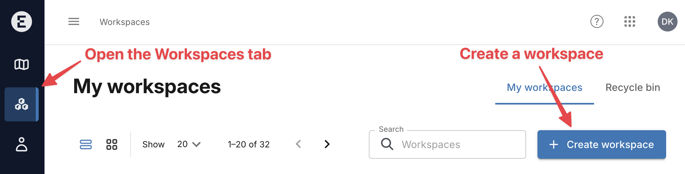

# Interactive DUF file to Evo data converter (Jupyter)

This code sample is a Jupyter notebook that converts the compatible layers of a Deswik Unified Files (DUF) into Evo geoscience objects and publishes them to an Evo workspace. Instead of editing scripts or configuration files, you sign in with your Bentley ID and use a small point-and-click form inside the notebook to select a DUF file and an Evo workspace and start the conversion.

If you need a hands-off, scheduled workflow instead, see the [automated DUF conversion sample](../duf-automated-conversion/README.md).

## Prerequisites

- [uv](https://github.com/astral-sh/uv) - Fast Python package installer and resolver
- An installed copy of Deswik.CAD

## Quick start

### 1. Register an Evo app

Register an Evo app in the [Seequent Developer Portal](https://developer.seequent.com/my-apps) to get your client credentials. If a member of your team has already registered a native app, you can ask them for the **client ID** and **redirect URL** instead. For more in-depth instructions, follow this [guide](https://developer.seequent.com/docs/guides/getting-started/apps-and-tokens) on the Seequent Developer Portal.

a. In a new browser tab or window, visit [https://developer.seequent.com/](https://developer.seequent.com/) and sign in.


b. Click **My apps** in the toolbar. You may need to agree to the developer terms and conditions before proceeding.


c. Click **Create app**.


d. Enter an application name and select the **Native** application type.


e. Click **Add new redirect URI**.


f. Click inside the text box to reveal a menu of common defaults, and select **Evo Python SDK default** (`http://localhost:3000/signin-callback`).


g. Click **Create app**.


h. The next screen displays the unique **Client ID** of your app. Save a copy, because you will need it to run the notebook. You can find this ID again by visiting [My apps](https://developer.seequent.com/my-apps) at a later date.


### 2. Obtain a local copy of this repository

If you want to focus on the code samples, or if you aren't comfortable using Git, download this repository as a ZIP file. Visit [https://github.com/SeequentEvo/evo-data-converters](https://github.com/SeequentEvo/evo-data-converters), click **Code**, then click **Download ZIP**. Extract the ZIP file to a folder on your computer.

Alternatively, if you are comfortable using Git:

```shell
git clone https://github.com/SeequentEvo/evo-data-converters.git
```

### 3. Set up your environment and launch the notebook

**Option A: Double-click `start-here.bat` (recommended)**

1. In **Windows Explorer**, open the local copy of this repository. It will be called **evo-data-converters-main** if you downloaded it as a ZIP file.
1. Browse to **code-samples** > **duf-jupyter-conversion**.
1. Double-click **start-here.bat**.

The script does the following:
- Installs [uv](https://github.com/astral-sh/uv), or updates it if it is already installed.
- Creates a Python virtual environment (`.venv`) and installs the dependencies the first time it runs.
- Opens `convert_duf.ipynb` in Jupyter in your web browser.

**Option B: Use the command line**

1. Right-click the **duf-jupyter-conversion** folder and choose **Open in Terminal**.
1. If you don't have `uv` yet, install it.
    ```pwsh
    powershell -ExecutionPolicy ByPass -c "irm https://astral.sh/uv/install.ps1 | iex"
    ```
    Changing the [execution policy](https://learn.microsoft.com/en-us/powershell/module/microsoft.powershell.core/about/about_execution_policies?view=powershell-7.4#powershell-execution-policies) allows a script from the internet to run.
1. Install the Python dependencies. You don't need to create a virtual environment manually, because `uv` does this for you.
    ```pwsh
    uv sync
    ```
1. Launch Jupyter.
    ```pwsh
    uv run jupyter notebook convert_duf.ipynb
    ```


### 4. Run the notebook

> [!TIP]
> Before running this notebook, make sure you have access to at least one Evo workspace. You can do this in two ways:
>
> - Ask a colleague to add you to an existing workspace.
> - Create a workspace by signing in to the [Evo portal](https://evo.seequent.com/), opening the **Workspaces** tab, clicking **Create workspace**, and following the instructions.
>
>   

a. In the first code cell, replace `<your-client-id>` and `<your-redirect-url>` with the **client ID** and **redirect URL** of your Evo app.

```python
client_id = "<your-client-id>"  # Replace with your client ID
redirect_url = "<your-redirect-url>"  # Replace with your redirect URL
```

b. Run the first code cell by pressing **Shift+Enter** or by clicking the **Run** button in the toolbar.

c. Sign in with your Bentley ID when your web browser asks you to. After you have signed in and granted access to the app, return to the tab where Jupyter is running.

d. Use the widget that appears to select your Evo instance and workspace. Converted objects will be published to this workspace.

e. Run the second code cell to display the DUF converter form, then follow the steps in **Using the converter form** below.

## Using the notebook

The form shows each section after you complete the one before it.

1. **Select DUF File**: Click the button to open a Windows file dialog and choose a `.duf` file. Only files with the `.duf` extension are accepted.
1. **Add CRS** (optional): By default, objects are published with an "Unspecified" coordinate reference system (CRS). Their coordinates are unchanged, but Evo can't use spatial search on them or align them with data in other coordinate systems. To set a CRS, tick **Add CRS** and enter the EPSG code for your data, for example `32750`. The code is validated as you type and the CRS name is shown when it is valid. If you aren't sure which code to use, search [epsg.io](https://epsg.io/).
1. **Object path** (optional): Enter the folder path in your Evo workspace where objects should be published, for example `/duf/converted`. Leave this empty to publish at the workspace root.
1. **Convert**: Click to start the conversion. A timer shows progress. When the conversion is complete, the form shows how many objects were published and an **Open Evo workspace** link to view them in the Evo portal.

The form remembers your last selected file, **Add CRS** choice, EPSG code, and object path. They are filled in automatically the next time you run the notebook.

### Advanced: choose which layers to convert

By default, every layer in the DUF file is converted. To convert only some layers, replace the second code cell with:

```python
from helpers.widgets import create_duf_widget_advanced

ui = await create_duf_widget_advanced(manager)
display(ui)
```

After you select a file, click **Read Layers** to list the layers in the DUF file. Tick the layers you want, or use **Select All Layers**, and then click **Convert & Publish**.

## How it works

The notebook calls `convert_duf` from the [evo-data-converters-duf](../../packages/duf/README.md) package with these settings:

| Setting | Value | Effect |
| --- | --- | --- |
| `combine_objects_in_layers` | `True` | Objects of the same type in a DUF layer are combined into a single Evo geoscience object. |
| `resolve_object_name` | `CONCATENATE` | Object names are built from the DUF layer and object names. |
| `overwrite_existing_objects` | `True` | Objects with the same path in the workspace are replaced by a new version. |
| `tags` | `Source: Auto-generated by DUF converter notebook` | This tag is added to every published object. |

To change these settings, edit [helpers/conversion.py](helpers/conversion.py).

## What's in this folder

| Path | Description |
| --- | --- |
| `convert_duf.ipynb` | The notebook to open and run. |
| `start-here.bat` | Installs `uv` and the dependencies, then launches the notebook. |
| `helpers/widgets.py` | The converter forms (`create_duf_widget` and `create_duf_widget_advanced`). |
| `helpers/conversion.py` | Reads DUF layers and calls the DUF converter. |
| `helpers/portal.py` | Builds the Evo portal link shown after publishing. |
| `example-data/` | Sample DUF files you can use to try out the notebook. |
| `notebook-data/` | Local cache for sign-in tokens, saved form values, and data files waiting to be uploaded. Created automatically and ignored by Git. |
| `pyproject.toml`, `uv.lock` | Python project and locked dependencies used by `uv`. |

## Sample data files

The `example-data` folder includes sample DUF files that you can use for testing:
- `Marlin Mapping v1.duf`
- `Marlin Stopes.duf`
- `Pit Mesh.duf`


## Additional resources

- [Seequent Developer Portal](https://developer.seequent.com/)
- [Evo geoscience objects](https://developer.seequent.com/docs/data-structures/geoscience-objects/)
- [Evo Python SDK code samples](https://github.com/SeequentEvo/evo-python-sdk/tree/main/code-samples)
- [DUF converter README](../../packages/duf/README.md)
- [Automated DUF conversion sample](../duf-automated-conversion/README.md)
